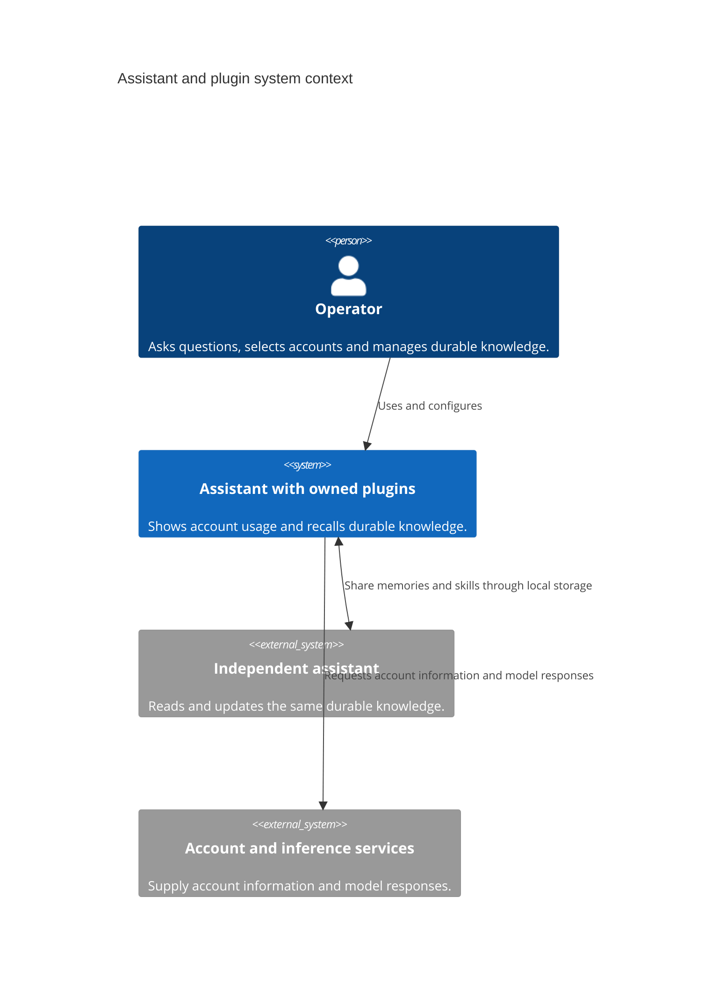
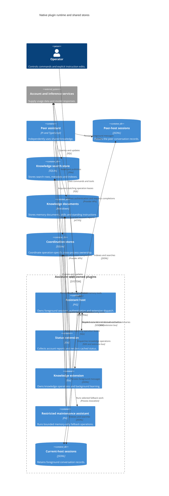
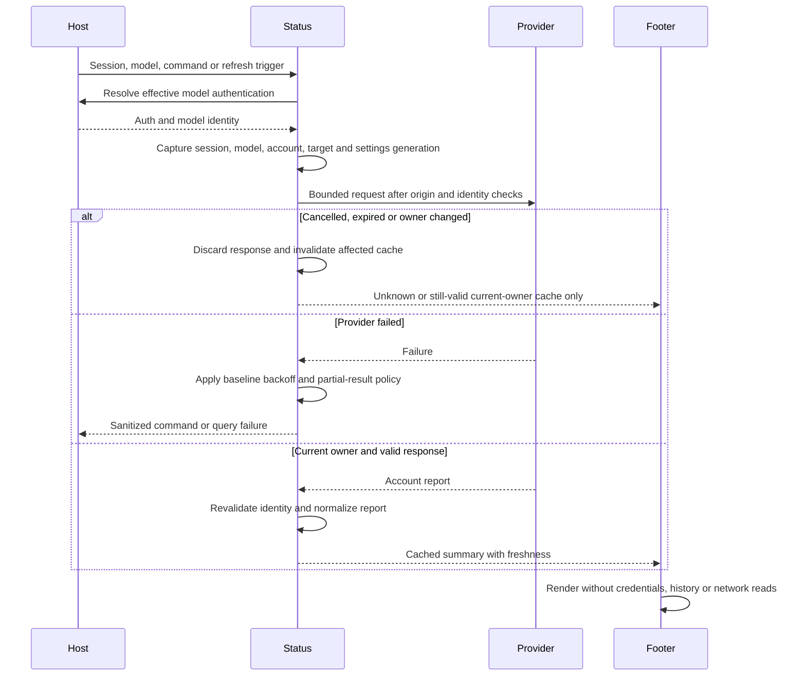
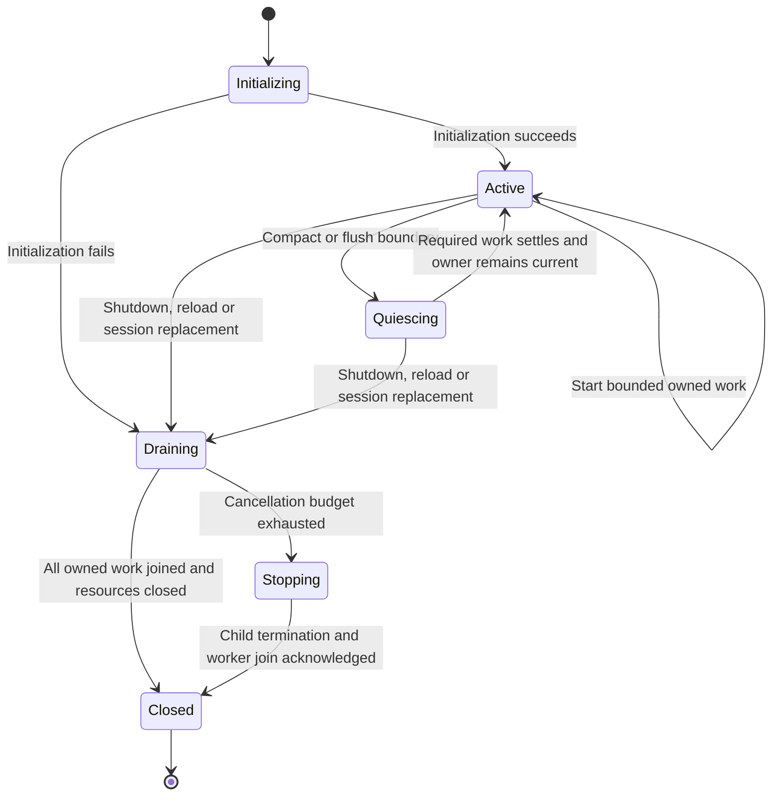
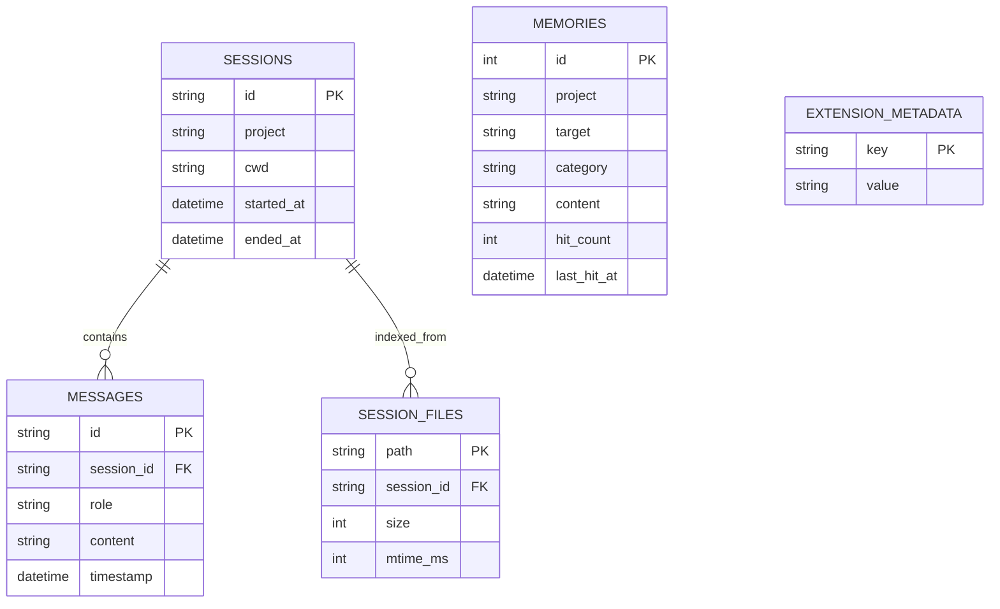
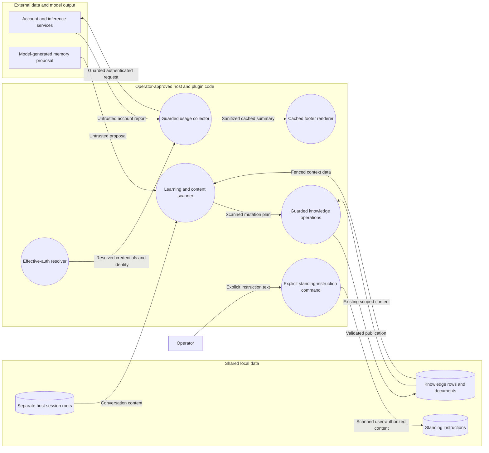
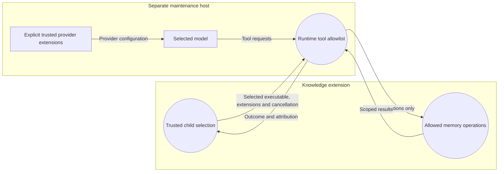

# Native plugin architecture

## Status and scope

These views specify the target architecture for [native status](native-usage.md) and [native Hermes](pig-hermes.md). They do not describe two completed ports. The installed status package still uses its pinned TypeScript collector; native Hermes is absent. [Compatibility findings](../compatibility/hermes.md) are feasibility evidence only.

Goals are feature parity, safe shared knowledge, responsive foreground work and native packaging. Non-goals are Pi runtime adapters in this package, a new knowledge service, a new schema, a telemetry platform, personal deployment changes and reduced-feature replacements.

## System context

The system in scope is the assistant with these plugins. The peer assistant is the independently running Pi installation. Sharing knowledge does not mean direct communication between the assistants.

Legend: person = operator; system = software in scope; external system = independently owned software. Storage and process placement appear below, not at context level.

## Target containers

Legend: container = runtime unit; database shape = persistent data; boundary = host composition. The coordination shape represents several databases, not one shared filename. Their exact identities are in the [storage contract](shared-storage.md#coordination-identities).

Normal extensions run as subprocesses. Compatible Go factories may be fused only after equivalent lifecycle and capability checks; this view does not require fusion. The current executable footer must be converted before it can be fused. The maintenance child is a separate host invocation, not a goroutine in the foreground host.

## Component ownership

| Owner | Owns | Allowed dependencies |
| --- | --- | --- |
| Status registration/adapter | Commands, host-auth resolution, public usage API adaptation and worker lifetime | Collector and host SDK |
| Status collector | Provider normalization, guarded requests, account/target selection, settings generation and report cache | Explicit auth snapshots, transport, clocks and cancellation |
| Footer | Cached summaries, width-aware presentation and opaque native bridge status | Cached state and presentation helpers only |
| Hermes registration/adapter | Schemas, commands, prompt resources, host calls and session lifetime | Domain owners and host SDK |
| Hermes store | Database access, Markdown mutation/reconciliation, lease protocol, recovery and maintenance | Explicit paths, clocks and cancellation |
| Hermes skills | Skill scope, collision/path guards and discovery | Document operations through the store's guarded boundary |
| Hermes sessions | Parsing, live/backfill indexing, retention and both search variants | Store and explicit session roots |
| Hermes learning | Review/correction/consolidation plans and scheduling | Store operations and an injected completion capability |

The SDK does not enter domain packages. Learning and session indexers do not open independent database connections or implement their own leases. Skills owns skill policy; the store owns guarded publication. Status has no Hermes or SQLite dependency. Create packages when needed, not as empty scaffolding.

## Usage refresh sequence

The public query API includes callbacks, cancellation and session object identity. Native adaptation is an early feasibility gate, not a claim that serializing the request preserves these semantics. Check it before porting providers. No fallback may change the account or query other providers without the existing explicit selection.

## Owned work lifecycle

This state machine describes target lifecycle ownership, not the contents of a persisted table.

A session owner contains a cancellation source, monotonically changing generation and a registry of outstanding operations. Request-scoped SDK contexts end with their handlers. Awaited work stays inside the handler; deliberately asynchronous work has independent ownership and obtains a fresh awaited host-call context through the characterized bridge.

1. Close admission before draining; stop refresh and review scheduling.
2. On ordinary shutdown, run the eligible baseline flush before cancelling the work that flush needs. Reload skips that flush. Session replacement cannot carry an old plan into the new session.
3. Apply each operation's captured baseline budget, propagate cancellation, terminate owned fallback processes when required and join them.
4. Finish or cancel indexers, learners and integrity scans before closing database handles. A failed initialization follows the same resource cleanup path without admitting learning work.
5. Reject publication from cancelled or replaced owners. A timeout is failure, not evidence of a clean drain. Never close a database beneath a live worker to make shutdown appear fast.

The host may force termination before cleanup finishes. Report that case as interrupted cleanup; crash/restart qualification must demonstrate recovery. The design does not assume cooperative cancellation always succeeds.

## Logical knowledge model

The logical relationships mirror upstream `src/store/schema.ts`; field selection below is explanatory, not a replacement schema. FTS indexes and triggers remain derived from their owning rows.

Skills and standing instructions are guarded documents, not new database tables. Project attribution is retained on rows; no new project registry is introduced. Lease rows belong to their operation-specific coordination databases, outside this logical knowledge model. [Shared storage](shared-storage.md) defines authority and partial-publication behavior.

## Trust boundaries and threats

These are data-flow diagrams: arrows carry data, not execution order. Trusted extension code runs with the operator's process privileges. Tool filtering restricts model-callable capabilities; it is not an operating-system sandbox for arbitrary provider-extension code.

| Threat | Required control | Qualification |
| --- | --- | --- |
| Account spoofing or credential disclosure | Effective host auth, official origins, header-override checks, account revalidation and redirect refusal | Local fixtures change credentials/model/target during requests and attempt redirects |
| Model output promoted into standing instructions | Separate explicit-user write path, content scans and prompt fencing | Automatic review, correction and consolidation cannot invoke the standing-instruction writer |
| Child gains file, shell, skill-management or MCP tools | Explicit child extension selection and runtime allowlist of `memory_add`, `memory_replace`, `memory_remove` only | Enumerate the real child's tools and attempt denied tool calls in a disposable process; do not rely on prompt wording |
| Untrusted provider code runs | Operator-approved provider-extension selection only; no model-selected executable/extension paths | Reject untrusted selection and preserve provider attribution; do not claim a sandbox |
| Path traversal, symlink escape or skill collision | Canonical identities, existing guards and conflict-safe moves | Unicode, missing-tail, alias-path, collision and concurrent-move corpus |
| Peer or external-editor write invalidates a plan | Shared operation identities and publication validation | Bounded concurrency model plus deterministic mixed-writer barriers |
| Recovery destroys readable data | Bounded recovery, retained readable rows, compatible schema and checked rollback | Corruption and crash fixtures including peers with open handles |
| Private content leaks through diagnostics | Fixed event/reason codes, redaction and no prompt/content/credential logging | Canary secrets and terminal-control characters never appear in retained diagnostic output |

External editors and peer writers can bypass this extension's scans. Treat their content as data on reads and never infer standing-instruction provenance merely because text appears in memory. Session roots are explicit data inputs; sharing knowledge never shares settings or authentication roots.

## Operational signals

Use host notifications, command/tool results and bounded diagnostic output. Do not add a telemetry backend. All diagnostic emission happens outside render callbacks.

Each operation has an ephemeral correlation ID, owner generation, operation kind, outcome, duration and a fixed reason code. Do not persist new operation history. Never include memory content, prompts, absolute private paths, account identifiers, credentials or arbitrary provider error bodies. Preserve baseline tool response fields and configuration-controlled notification behavior; additional diagnostics are not new public tool fields.

| Failure | User-visible behavior | Resource behavior |
| --- | --- | --- |
| Usage request fails or becomes stale | Preserve structured failure reason; `/usage` explains the sanitized failure; footer never invents zero | Preserve valid current-owner cache only until its baseline expiry, then show unknown; use baseline backoff |
| Lease busy or lost | Explicit deferred/conflict/cancelled operation, not plain success | Do not publish an obsolete plan; release only the owned token |
| Knowledge document saved but search reconciliation fails | Preserve partial-success warning and `/memory-sync-markdown` repair advice | Retain the durable document and mark search state degraded; do not repeat the mutation blindly |
| Integrity scan or recovery fails | Sanitized degraded/recovery diagnostic and baseline operation failure | Retain backups/readable data, stop unsafe writes and honor recovery circuit limits |
| Live index or backfill fails | Bounded indexing warning; search results are not represented as complete | Preserve retryable file metadata and cancellation ownership |
| Review or fallback fails | Preserve no-op/failure distinction, configured warnings and attribution | Cancel and join owned work; never mutate foreground conversation state |
| Drain exceeds budget | Explicit interrupted-cleanup diagnostic | Cancel/terminate and join; do not report clean shutdown from exit status alone |

Coalesce repeated background diagnostics by operation kind, owner and reason until recovery or owner change; explicit command/tool failures are always returned. Use process-local bounded state only. A new optional diagnostics configuration requires its own contract review.

## Decision records and validation

- [Native runtime and ownership](../adr/0001-native-runtime-ownership.md)
- [Frozen shared-storage baseline and safety gate](../adr/0002-frozen-shared-storage.md)
- [SQLite driver candidate](../adr/0003-sqlite-driver-candidate.md)
- [Consumer-derived Hermes parity](hermes-parity.md)

Checkpoint evidence must identify the source/host versions, selected composition, fixture, command, result and retained artifact hashes. A registration capture, a model, an offline fixture, a platform run and a live-provider result answer different questions; none substitutes for the others. No deployment, source publication or live-data change follows from a diagram or a checked document alone.
