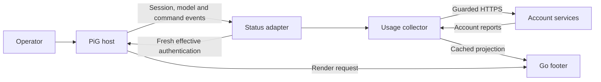
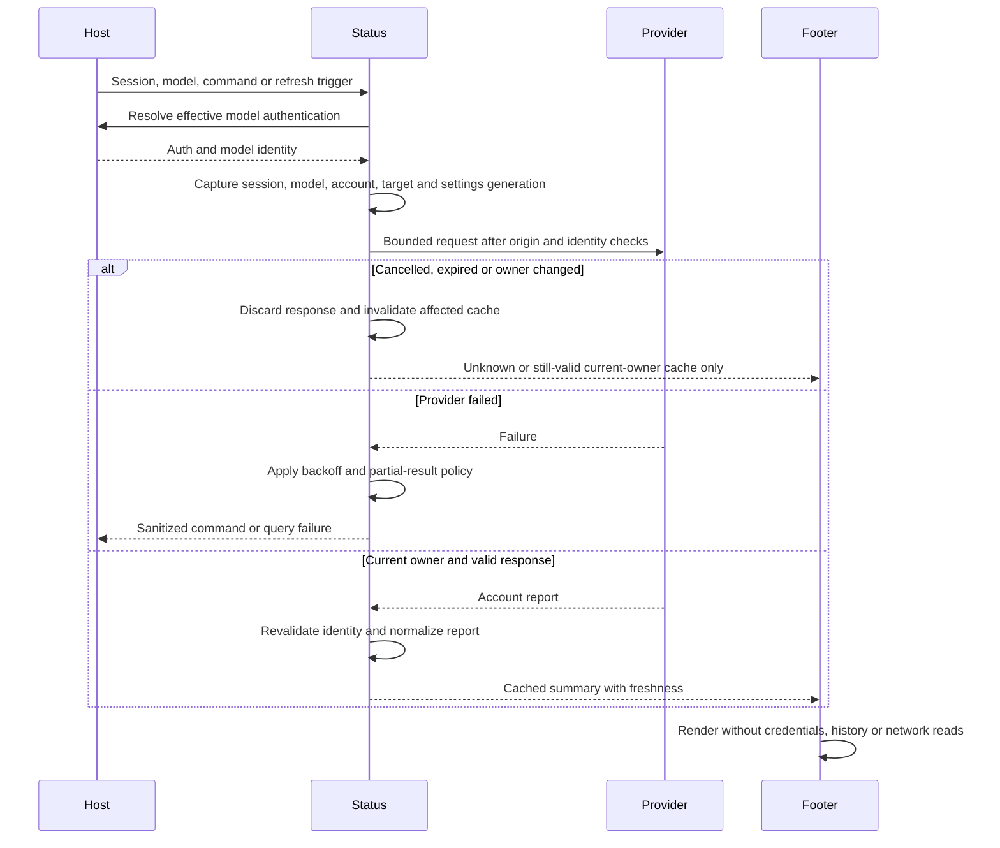

# Native status architecture

## Status and scope

These views specify the target architecture for [native usage](native-usage.md). The installed package still uses the pinned TypeScript collector and a Go footer. [ADR 0005](../adr/0005-feature-level-native-scope.md) defines source-led feature verification rather than exact upstream parity.

This package runs only in PiG. Personal configuration and deployment selection belong in the consuming dotfiles repository. The native usage port preserves provider, account, settings and command workflows before replacing the selected collector.

## Runtime and ownership

Normal extensions run as subprocesses. Compatible Go factories may be fused only after equivalent lifecycle and capability checks. The footer module is a standalone executable built from `status.New` in `extensions/pig-status/status`. The conventional factory is `nativeusage.Extension`, in its own module. One module root holds either a factory or a standalone main, never both; fusion is not required.

| Owner | Owns | Allowed dependencies |
| --- | --- | --- |
| Status registration/adapter | Commands, host-auth resolution and worker lifetime | Collector and host SDK |
| Status collector | Provider normalization, guarded requests, account/target selection, settings generation and report cache | Explicit auth snapshots, transport, clocks and cancellation |
| Footer | Cached summaries, width-aware presentation and opaque native bridge status | Cached state and presentation helpers only |

The SDK stays at the extension boundary. The footer performs no network, credential or history reads.

## Usage refresh sequence

The collector publishes to the footer in process; the footer is the only usage consumer. Native status exposes no public usage event API ([ADR 0004](../adr/0004-no-public-usage-event-api.md)). No fallback may change the account or query other providers without explicit selection.

## Owned work lifecycle

A session owner has cancellation, a generation and tracked outstanding operations. Request-scoped SDK contexts end with their handlers. Awaited work stays inside the handler; asynchronous scheduling obtains a fresh awaited host-call context rather than retaining an old one.

1. Close admission and stop refresh scheduling before draining.
2. Cancel owned work and join the scheduler and admitted listeners before replacement or shutdown.
3. Reject publication from cancelled or replaced owners.
4. Unregister private listeners and clear cached publication before starting a successor.
5. Report failed or interrupted cleanup honestly; a timeout is not a clean drain.

The staged adapter's private wakeup carries no reports or credentials. Each timer waits for the prior emission to settle, avoiding overlapping tick queues.

## Trust boundaries and checks

| Threat | Required control | Focused verification |
| --- | --- | --- |
| Credential disclosure or account spoofing | Effective host auth, official origins, header-override checks, account revalidation and redirect refusal | Local fixtures change credentials/model/target during requests and attempt redirects |
| Old response reaches a new owner | Complete session/model/account/target/settings identity and generation fences | Held HTTPS responses cross model, settings and owner replacement |
| Provider response exhausts resources | Bounded response bodies, total deadline and concurrency | Oversized bodies, cancellation, deadline and queued requests |
| Diagnostics expose private data | Fixed sanitized failure reasons, no credentials or arbitrary provider bodies | Synthetic canary secrets and terminal-control characters |
| Footer blocks foreground rendering | Cache-only render callback | Terminal checks at wide and narrow widths |

All fixtures use disposable synthetic roots. Local fixture proof does not qualify live accounts or authorize deployment.

## Operational signals

Use host notifications, command results and bounded process-local diagnostics, not a telemetry backend. Diagnostic work stays outside render callbacks. Never include credentials, account identifiers, prompts, private paths or arbitrary provider error bodies.

When requests fail, preserve valid current-owner cache only until expiry, then show unknown. `/usage` returns a sanitized failure rather than inventing zero quota. Coalesce repeated background failure notifications until recovery or owner change; explicit command failures remain visible.

## Decision records and validation

- [Native runtime and ownership](../adr/0001-native-runtime-ownership.md)
- [No public usage event API](../adr/0004-no-public-usage-event-api.md)
- [Feature-level native scope](../adr/0005-feature-level-native-scope.md)

Evidence identifies the source/host versions, selected composition, fixture, command and result. Registration, offline fixtures, platform checks and live-provider results answer different questions. None alone authorizes cutover, publication or live-data changes.
