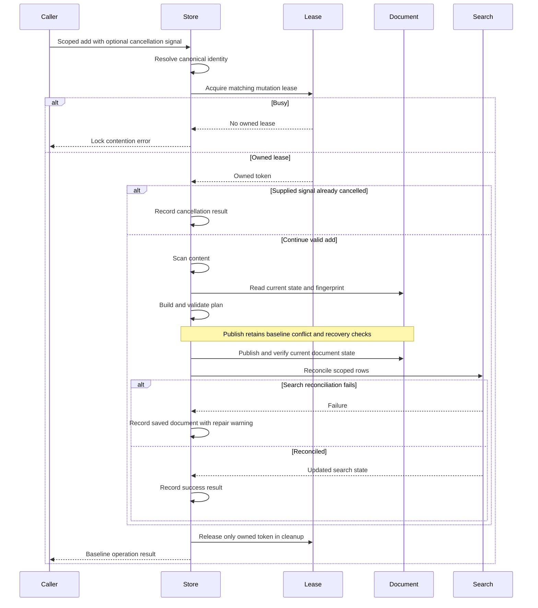

# Shared knowledge storage contract

## Status and authority

This contract refines [native Hermes](pig-hermes.md), not the TypeScript writer. Source paths below refer to the exact [frozen baseline](../compatibility/hermes-baseline.json). The [decision record](../adr/0002-frozen-shared-storage.md) requires separate approval for any shared protocol change.

The knowledge root is resolved by the baseline path/configuration code. PiG installation does not move it. Canonicalize symlinks and missing final components exactly as `src/store/canonical-storage-path.ts` does. Project identity binds from the session/tool working directory, not the extension process's startup directory.

| Data or mode | Authority and publication |
| --- | --- |
| `policy-only` | SQLite supplies searchable knowledge. Memory tools still mutate Markdown through `MemoryStore` and reconcile rows through their mutation observer. `MemoryStore.capEnforced` disables legacy character-cap enforcement in this mode. Do not add truncation or assume a SQLite-only write protocol. |
| `legacy-inject` | Preserve Markdown limits and the frozen injected prompt snapshot. Mutations reconcile the SQLite search mirror. |
| Memory mutation result | A successful document write and failed SQLite reconciliation is partial success with the baseline repair warning, not an atomic rollback of both stores. Preserve duplicate/matching and external-edit reconciliation behavior. |
| Skills and standing instructions | Guarded documents retain their existing scope, formatting, permissions and discovery rules. Standing instructions require explicit user action. |
| Session search | Legacy search reads the shared index; anchor search reads session files. Both hosts' roots must be deliberate inputs, with source paths retained in results/metadata. |
| Search indexes | FTS5 trigram indexes and triggers derive from the baseline schema. Preserve short-query/ranking/error behavior, hit counts, timestamps and project attribution. |

Query authority is not a claim that Markdown and SQLite share one transaction. Preserve recoverable partial-success states rather than returning an invented all-or-nothing result.

## Coordination identities

Port the coordinator representation and each caller's database/key selection. Sharing a table schema or a Go mutex is insufficient. `I` is the canonical document identity; `D` is the canonical database path. `AGENT_ROOT` here is the shared baseline root, not automatically PiG's configuration root.

| Operation | Coordination database | Key | Baseline timing |
| --- | --- | --- | --- |
| Markdown mutation | `dirname(dirname(I))/.pi-hermes-locks.sqlite` | `mutation:` + `I` | Wait 5,000 ms; poll 10 ms; stale 300,000 ms |
| Consolidation | `<root>/locks.sqlite`, where root is nonempty trimmed `PI_HERMES_CONSOLIDATION_LOCK_DIR`, otherwise `AGENT_ROOT/pi-hermes-memory/.consolidation-locks` | `sanitize(toolTarget):sanitize(target):sha256(storageIdentity)` | Wait 5,000 ms by default, poll 50 ms; stale 45,000 ms; renew every 10,000 ms |
| Database recovery | `dirname(D)/.pi-hermes-locks.sqlite` | `recovery:` + `D` | Default wait 5,000 ms; poll 50 ms; stale 300,000 ms; preserve recovery-option overrides |

Sources: `src/store/markdown-mutation-lock.ts`, `src/handlers/auto-consolidate.ts`, `src/store/db.ts`, and `src/store/atomic-lock-coordinator.ts`.

Consolidation sanitization replaces runs outside ASCII letters/digits/`.`/`_`/`-` with `_`, truncates to 80 JavaScript string units and uses `unknown` when empty. Hash the baseline storage identity bytes, not a display path. `PI_HERMES_CONSOLIDATION_LOCK_WAIT_MS` uses the baseline numeric conversion: finite nonnegative values override the wait, including zero. Recovery defaults also retain the three-failure/300,000-ms circuit and three-backup retention unless configured otherwise through the baseline recovery options.

Lease rows retain `lock_key`, `token`, `pid`, `incarnation` and millisecond `acquired_at`. Acquisition uses `BEGIN IMMEDIATE`. Preserve PID/incarnation liveness, unknown-incarnation handling, stale takeover, token-checked renew/release, pending-release retries and bounded dead-row cleanup. A live PID alone does not prevent time-based stale takeover. Native and TypeScript fixtures must compare concrete database paths and keys for global, project, symlinked and configured roots.

## Mutation sequence and partial success

This sequence describes the baseline document-backed add path for valid content, including busy-lock, cancellation and search-reconciliation outcomes. Policy-only search authority does not remove it. Replace/remove and validation/no-op outcomes have their own corpus rows; this view does not imply identical cancellation arguments for every action.

On publication failure, preserve the baseline bounded external-write retries, conflict/recovery artifacts and reload-from-disk behavior. The baseline add path checks its supplied signal after acquisition; its lock wait is not itself signal-aware. Capture replace/remove separately rather than assuming they receive the same signal. Native cancellation and durable-write reporting must match the executable corpus and must not turn an already durable write into a false no-write claim. A proposed public cancellation change requires a decision, not an inaccurate baseline diagram.

## Publication-safety gate

**Cutover is blocked until this gate passes.** The owner chose to keep the TypeScript baseline frozen. Matching its locks is necessary but does not prove that a stale process cannot overwrite a newer result.

The coordinator's `isCurrentOwner` comment explicitly describes a remaining check-then-act race. Token-checked release and renewal protect the lease row, not the later filesystem rename or knowledge transaction. The current probes do not implement a complete native acquisition/publication path and do not prove crash or stale-takeover safety. Do not silently replace the baseline protocol, disable stale takeover, add another lock file or declare a pre-write ownership check atomic.

Before accepting H2 publication code:

1. Describe each path's actual linearization point and lock order: memory add/replace/remove, consolidation, external-edit reconciliation and database recovery. Identify every durable write and filesystem rename, including WAL/SHM and rollback artifacts. Do not hold a database transaction across a model request.
2. Build a bounded, exhaustively explored model with at least two writers, a lease token, time-based takeover, renewal, document version/fingerprint, database state and crash/restart transitions. Model each ownership check separately from each durable write; an indivisible check-and-publish action is allowed only when an actual primitive implements it.
3. Explore pause after ownership/fingerprint checks, peer takeover and publication, stale-holder resume, PID reuse/unknown incarnation, failed renewal/release, clock movement, partial document/search reconciliation and recovery while a peer holds an open database handle.
4. Assert no accepted update is silently lost; a stale plan cannot replace a newer committed version; an old token cannot renew/release a successor; recovery preserves readable rows; partial success is reported and repairable. State filesystem, same-machine PID visibility and crash assumptions explicitly. The bounded model does not prove behavior outside those assumptions.
5. Turn every counterexample and representative successful interleaving into a deterministic disposable TypeScript/Go process test with barriers. Compare final documents, rows, scope, metadata and reported outcomes, not only exit codes or `integrity_check`.
6. If the frozen writer violates an invariant, retain the counterexample and stop qualification. A coordinated TypeScript/Go safety patch, revised baseline and rollout need a separate owner decision. A native-only workaround or a narrower assertion does not pass.

The model and concrete mixed-writer tests are required H2 artifacts, not evidence already obtained. H2 development may use disposable stores; no live write or activation is authorized. The absent proof is an explicit release blocker, not an invented safe implementation.

## Recovery and rollback qualification

Retain the baseline recovery circuit, backup caps and readable-row rebuild. Validate peer connections across database file replacement, corruption during indexing, process death between document publication and reconciliation, and failed restoration. A lease in a separate database does not by itself revoke another process's open knowledge handle.

Rehearse backup/restore and switching the PiG extension selection on disposable stores while Pi's TypeScript writer remains compatible. Check that restored documents, rows, schema, skills and provenance are readable by both implementations. A successful source build is not rollback evidence. Live backup or activation remains separately authorized work.
